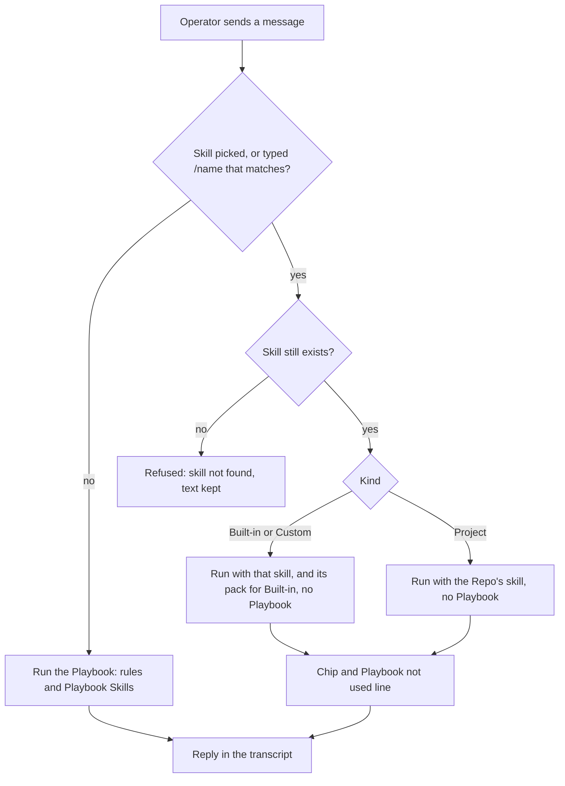

# Skill Kinds in Session

**Status:** shipped
**Design:** Skills page, the Playbook editor's Skills section and the Session composer in the Workspace tab of
`design/ops-console.html`, all drawn with this spec: Discover / Yours on the Skills page, the `/` menu above the
composer, and the skill chip on a message. Flow diagrams: `docs/diagrams/skill-message-routing.html` and
`docs/diagrams/skill-menu-sources.html`.

## Problem

The console has one kind of Skill: text the operator writes and attaches to a Playbook. The operator cannot get a
ready-made Skill without writing it, cannot call a Skill from a Session on purpose, and cannot reach the skills a Repo
already ships in its own code. A Session message always runs the Playbook for its Trigger, so a Skill the operator
wants to use for one task competes with the Playbook's rules instead of replacing them. The operator wants Skills sorted
by where they come from, a menu in the composer that shows them, and a clear rule: a message that names a skill runs
that skill, and every other message runs the Playbook.

## Behavior

### Skills page

1. The Skills page has two tabs, Discover first and Yours second, and opens on Discover. New Skill shows on Yours only.
   Yours lists only the operator's own Custom Skills, A to Z, each
   with the number of Playbooks that hold it. A pack's skills never show in Yours. With none, it keeps its tabs and says
   "No Skills yet."; the header's New Skill starts the first.
2. Custom Skills work as in `playbook-skills`. A Custom Skill cannot take the name of any built-in skill, installed or
   not: the save is refused and names the clash.
3. A Built-in skill is read in its pack under Discover: opening it there shows its instructions and the Playbooks that
   hold it. It has no edit and no delete of its own; Uninstall on its pack is the only way out. A link to one skill (from a
   Playbook or a job card) opens its pack with that skill open.
4. Discover lists Skill packs: name, description, number of skills, and Install or Installed. Opening a pack lists its
   skills, each opening to its text. Two packs ship: Ops Console and Caveman.
5. Install makes every skill of the pack available at once to Playbooks and the `/` menu. Installing an installed pack
   changes nothing.
6. Uninstall asks first and names the Playbooks that hold any of the pack's skills. Confirming removes the skills from
   those Playbooks and from the menu. A job already running keeps what it copied; a Session's `/` menu loses the skills on
   its next open.
7. The open Playbook's Skills picker offers installed Built-in skills and Custom Skills, each with its badge. The limit of
   8 counts both. Duplicating a Playbook copies both.

### The `/` menu

8. Typing `/` as the first character of the composer opens a menu above it. It lists Custom Skills, installed Built-in
   skills and, in a Session that has a Repo, the Project skills in that Repo's working folder. An Anonymous Session
   shows no Project skills; one that joins a Repo shows them from then on. A dev-tools Session and a pull request's
   reply Session have no menu: `/` is typed text there.
9. Text after `/` narrows the list. Names that start with it come first, then names that hold it, then descriptions
   that hold it, each A to Z, ignoring case, so `/pr` puts the skill named `pr` first and `/code` finds Code Review and
   Codebase Design. Entries with the same name all show, each with its badge: a Project
   `pr` and a Built-in `pr` both appear.
10. Each row shows `/name`, the description cut to one line, and a badge: Built-in, Custom or Project. Enter or a click
    puts `/name ` in the composer and leaves what the operator typed after it.
11. The menu reads the skills each time it opens: one installed, created or added to the Repo shows at the next open.
    The menu reads only each skill's name and description. With no skills at all it says so and points to Discover. With
    no match it says "No skills match".
12. A Project skill is a folder in the Repo's working folder with a `SKILL.md` whose header gives a name and a
    description. A folder without a valid header is skipped, not listed.

### Running a message

13. A message that does not start with a skill runs the Playbook for its Trigger as before: its rules and its Skills.
    Every job (Verification, Fix, Agent Review, Reply check, Comment pass) runs its Playbook; a job has no skill message.
14. A skill message is `/name` and a free note, such as `/code-review the auth changes only`. The skill is what the agent
    works from, and the note is the task it is given. The run uses no Playbook rules and no Playbook Skills, for that
    message only. The next plain message follows the Playbook again.
15. Custom: the agent gets that one skill. Built-in: the agent gets that skill with the rest of its installed pack, so
    the skills of a pack can call one another (`ship` runs `spec`, `code-review`, `commit-message` and `pr`). Project: the agent gets the Repo's own skill, read the way Claude
    Code reads it, with the Session's settings as today. Other skills the agent may load on its own stay as in a run with
    no Playbook.
16. Picking from the menu fixes the exact skill. A typed `/name` that matches several resolves as Project first, then
    Custom or Built-in. A typed `/name` that matches none is a plain message and runs the Playbook.
17. A skill message shows a chip with the skill's name and kind badge, and a muted line "Playbook not used for this
    message". The transcript shows both after a reload and during a run that is still streaming.
18. The skill is gone when the operator sends (uninstalled, deleted, or its folder removed after the menu opened): the
    send is refused with "skill not found", no run starts, and the text stays in the composer.
19. A skill adds method and never relaxes a rule. PROD writes still ask for Approval in every Access mode, and the
    Run sandbox and Network allowlist apply. A skill that says to merge, push or read a secret changes nothing.
20. A Session whose run is still going refuses the send as today. Two Sessions that use the same skill each get their own
    copy; a stopped or finished run leaves nothing behind. A skill message whose console skill cannot be handed to the run
    fails with the reason, as a Playbook Skill does, and does not run without it.
21. Editing a message resolves its leading `/name` again, by 16. A retry keeps the skill the message had.
22. When the agent loads the skill, the Action Log records an action of kind `skill` with its name, as in
    `playbook-skills`.
23. Must not regress: Playbook Skills (`playbook-skills` 10 to 16), a job's snapshot of its Skills, and the rule that a
    skill file in a Repo's own code does not load in a run that holds Playbook Skills.

### Message routing

Drawn in `docs/diagrams/skill-message-routing.html`; what the menu lists, by Session kind, in `docs/diagrams/skill-menu-sources.html`.



## Settled

- **Badge**: a Built-in skill's badge names its pack (Caveman, Ops Console), beside Custom and Project. The kind stays
  `builtin` in code and the API.
- **Kinds**: Built-in (shipped by the console in a pack, installed by the operator, read-only), Custom (written by the
  operator, global to every Session), Project (a skill in the Repo's own folder, read-only, never on the Skills page).
- **Pack**: Built-in skills come in packs. Install and uninstall act on the whole pack; each skill of an installed pack
  is its own menu entry and attaches to Playbooks on its own.
- **Caveman pack**: `caveman`, `caveman-commit`, `caveman-review`, `investigate-first`, `lean-build`, `migration`,
  `safe-refactor`, `surgical-patch`, `verify-and-stop`. Text only, copied into the console from the Caveman plugin
  (Apache-2.0) with its notice. Left out: skills that need scripts, subagents or Caveman Cloud.
- **Ops Console pack**: `code-review`, `commit-message`, `grilling`, `humanizer`, `pr`, `refactor`, `retro`, `ship`,
  `spec`. Text only, written for any Repo, adapted from mattpocock/skills (MIT), blader/humanizer (MIT) and Dex Horthy's
  `show-me` (Apache-2.0), with their notices; `refactor` is original. They follow the safety rules of the console: work
  is committed on a branch, a run never pushes, opens or merges a pull request (it asks the console's tool), and commit
  hooks are never skipped.
- **Built-in text is live**: Built-in skills read from the console, so an update to the console changes them. A job
  copies what it was offered when it starts, as before; a chat reads live.
- **Where the tag lives**: the message. A Session has no skill mode. The Playbook is the default and a skill message the
  exception, for that message only.
- **Names**: a Custom name cannot equal any built-in skill name. A Custom Skill that already has one is renamed with
  `-custom` added when this ships.
- **Anonymous Session**: Built-in and Custom only.
- **Job snapshot**: each Skill in it gains a kind; a snapshot without one reads as Custom.
- **Order**: lists sort A to Z, ignoring case.
- **Retry and Play**: a run that began with a skill goes on with it: the carry-on text is sent with the same skill, and
  the message shows the chip again.
- **Queued message**: it names its skill by its typed `/name` when it sends, since the queue keeps text only.

## Not required

- **Personal skills**: skills in `~/.claude`, including Caveman installed as a Claude plugin, never show. A Mac with the
  plugin sees the console's own Built-in copy only.
- **Proof the skill was followed**: the console shows which skill ran, not whether the agent used the note well.
- **A fresh menu while open**: the menu is read when it opens; a skill added while it is open shows at the next open.
- **Per-skill uninstall**: a pack goes whole.

## Safety

No change. A skill is text read through the same channel as Playbook rules. It adds no tool, Connection, command or file
access. A Project skill is read from the Repo's working folder by Claude Code's own loading, under the same Run sandbox.

## Database

```sql
CREATE TABLE installed_skill_packs (
  pack_id TEXT PRIMARY KEY, -- id of a pack in the console's catalog
  installed_at TEXT NOT NULL
);

CREATE TABLE playbook_builtin_skills (
  playbook_id TEXT NOT NULL REFERENCES playbooks (id) ON DELETE CASCADE,
  pack_id TEXT NOT NULL,
  skill_name TEXT NOT NULL,
  PRIMARY KEY (playbook_id, pack_id, skill_name)
);
CREATE INDEX playbook_builtin_skills_pack_idx ON playbook_builtin_skills (pack_id);

CREATE TABLE message_skills (
  id TEXT PRIMARY KEY,
  session_id TEXT NOT NULL REFERENCES sessions (id) ON DELETE CASCADE,
  prompt TEXT NOT NULL, -- what the agent got; the transcript holds only this, so it finds the message again
  typed TEXT NOT NULL, -- what the operator typed, shown in place of the prompt
  kind TEXT NOT NULL CHECK (kind IN ('builtin', 'custom', 'project')),
  name TEXT NOT NULL,
  created_at TEXT NOT NULL -- the run's start, so a retry finds the skill of the run it repeats
);
CREATE INDEX message_skills_session_idx ON message_skills (session_id, created_at);
```

Migration: a Custom Skill whose name equals a built-in skill name is renamed with `-custom` added (`-custom-2` if that
is taken). No pack is installed, no message has a skill. A job snapshot with no `kind` reads as Custom.

## API

### Common

`SkillRef`:

```json
{ "kind": "builtin | custom | project", "name": "code-review" }
```

| Status | Error code | When |
| ------ | ---------- | ---- |
| 404 | `skill_not_found` | The skill in a `SkillRef` no longer exists |
| 404 | `not_found` | No pack, Session or Repo with that id |
| 409 | `read_only` | An edit or delete of a Built-in skill |

### `GET /api/skills`

Each `Skill` gains `kind: "builtin" | "custom"` and `pack: string | null`. The list holds Custom Skills and installed
Built-in skills, A to Z. A Built-in skill's `id` is `builtin:<pack_id>/<name>`. `PATCH` and `DELETE` on one return
`409 read_only`.

### `GET /api/skill-packs`

```json
{ "data": { "items": [{ "id": "caveman", "name": "Caveman", "description": "…", "installed": true,
  "skills": [{ "name": "caveman-commit", "description": "…", "instructions": "…" }] }] } }
```

### `POST /api/skill-packs/:id/install`, `DELETE /api/skill-packs/:id/install`

Install returns the pack; installing an installed pack changes nothing. Uninstall returns 204 and takes the pack's
skills off every Playbook.

### `GET /api/skill-menu`

Query: `session_id?`, `repo_id?`, `q?`. A Session id decides the kinds by the Session's Repo; a Repo id serves a Session
not yet created; neither gives the Anonymous list. Returns:

```json
{ "data": { "items": [{ "kind": "project", "name": "pr", "description": "…", "pack": null }] } }
```

Items sort as in Behavior 9.

### `POST /api/playbooks`, `PATCH /api/playbooks/:id`

`skill_ids` also takes `builtin:<pack_id>/<name>` ids. An id of a skill whose pack is not installed is `404 not_found`.
The limit of 8 counts both kinds.

### `POST /sessions/:id/messages`

Body gains `skill?: SkillRef`. Every endpoint that sends a message, including the first message of a new Session, takes
the same field. `text` holds what the operator typed, `/name` included. `Message` gains `skill: SkillRef | null`.

### WebSocket `skills.changed`

Fires also after a pack is installed or uninstalled.

## UI

- **Skills page**: tabs Discover and Yours, opening on Discover; New Skill in the header on Yours only. Yours: the Custom Skills and their editor. Discover: the packs and the open
  pack, each of its skills opening to read-only text, with Install or Uninstall. States: loading, empty, error with
  retry. Departs from the design: Discover / Yours is new.
- **Playbook editor**: the Skills picker shows both kinds with badges.
- **Session composer**: the `/` menu above the composer, rows as in Behavior 10, states loading, none installed, no match,
  error. Keyboard: arrows move, Enter or Tab picks, Escape closes.
- **Message**: a chip and the muted line, as in Behavior 17.
- No PROD state: a skill reaches no Connection.

## Rejected

- **Personal skills from `~/.claude`**: ties a run to one Mac's files, as `playbook-skills` found.
- **Install copies the text into Yours**: an edited copy drifts from the console's version and a console update never
  reaches it.
- **Skill mode toggle on the Session**: one more state to forget; the tag on the message says what runs.
- **Stop following the Playbook when the agent loads a skill itself**: the rules are already in the prompt, so the console
  cannot take them back.
- **Catalog fetched from GitHub**: reaches outside the machine and needs trust the console cannot check.
- **Menu shows only the name**: the operator picks by what a skill does, so the description stays.

## Glossary

- **Skill**: add "Built-in skills and Custom Skills" to the definition; Project skills are not Skills.
- **Built-in skill**: A Skill the console ships in a pack. The operator installs it; it is read-only.
- **Skill pack**: A set of Built-in skills installed and uninstalled together.
- **Custom Skill**: A Skill the operator wrote, available to every Session.
- **Project skill**: A skill in a Repo's own folder. A Session in that Repo may call it; the console does not keep it.
- **Skill message**: A Session message that starts with `/name`. It runs that skill and not the Playbook.

## ADR

None. Reversible, and it follows ADR 0005: Claude Code's own skill loading stays the integration point.

## Seams

- **Skills service** (backend + SQLite): 1, 2, 3, 4, 5, 6, 7, 8, 9, 11, 12, 16, 18, 21. Packs, catalog, name rules, menu by
  Session kind, resolution and refusal.
- **Run options** (unit, over the Agent SDK fake): 13, 14, 15, 19, 20, 22, 23. Asserts the options each kind passes and
  that a plain message and every job still pass the Playbook's.
- **Session composer and Skills page** (browser, Playwright against the built daemon): 1, 4, 5, 6, 8, 10, 11, 17, 18.

## Out of scope

- Personal skills, per-skill uninstall, a GitHub catalog.
- Project skills in pull request and dev-tools Sessions.
- Skills with scripts or files.
